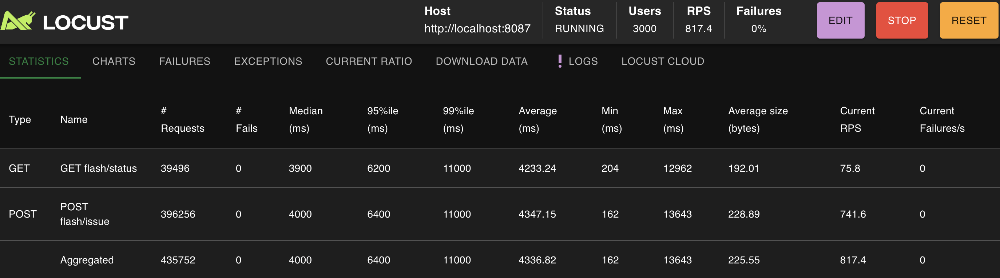

# 선착순 쿠폰 Locust 부하 테스트

선착순 1000장 쿠폰 · local/docker 전용

## 설치

**로컬 하이브리드** (IntelliJ `local` + 인프라 Docker)

```bash
cd moodly-api/docker-compose && docker compose up -d
# IntelliJ: CouponServiceApplication (profile: local)
```

**전체 Docker** (`--profile app` — coupon-service 포함)

```bash
cd moodly-api/docker-compose && docker compose --profile app up -d --build
# 호스트 8087 publish → reset·Locust 동일
```

```bash
cd moodly-api/load-test
python3 -m venv .venv && source .venv/bin/activate
pip install -r requirements.txt
```

## 실행

```bash
./scripts/reset_flash_coupon.sh
locust -f locustfile.py --host=http://localhost:8087
```

http://localhost:8089 → Users **3000**, Ramp up **200**, Host `http://localhost:8087` → **Start**

## 결과 (local 1대 기준)

| 지표 | 값 |
|------|-----|
| Failures | **0%** |
| RPS | **~817** |
| Median | ~4s |
| 95%ile | ~6.4s |



테스트 후: `curl -s http://localhost:8087/coupon/flash/status` → `issuedQuantity: 1000`

## 재실행 / 재시작

**부하 테스트 다시 돌릴 때** (매 회)

```bash
cd moodly-api/load-test
source .venv/bin/activate
./scripts/reset_flash_coupon.sh
locust -f locustfile.py --host=http://localhost:8087
# → http://localhost:8089 에서 Start
```

**Locust만 재시작** — 터미널에서 `Ctrl+C` 후 위 `locust` 명령 다시 실행

**coupon-service 재시작** — IntelliJ에서 `CouponServiceApplication` Stop → Run (profile: `local`)

**인프라(Docker) 재시작**

```bash
cd moodly-api/docker-compose
docker compose down && docker compose up -d
# 이후 coupon-service + reset + locust 순서로 다시 실행
```

## 트러블슈팅

| 증상 | 해결 |
|------|------|
| **8087 연결 실패** | `docker compose --profile app` 기동 여부, `curl http://localhost:8087/actuator/health` |
| **8089 접속 불가** | `locust -f locustfile.py --host=http://localhost:8087` 실행 여부 확인 |
| **Failures ~90%** | issue API 403 → coupon-service `local` 프로필로 재시작 |
| **403 on issue** | `application-local.yml`에 `load-test.enabled: true` 확인 후 재시작 |
| **발급 > 1000** | `./scripts/reset_flash_coupon.sh` 후 재테스트 |
